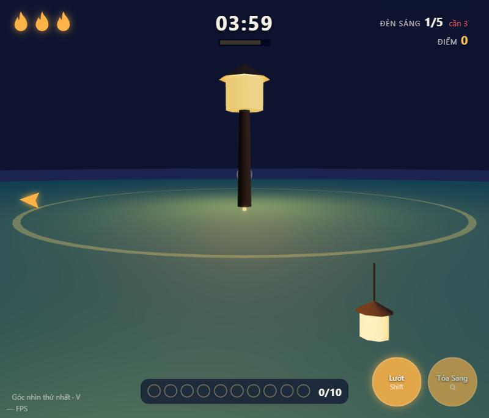

# Đảo Đèn Lồng 🏮 — v1.0.0

> 🎬 **Video demo (2:40):** [docs/demo/demo.mp4](docs/demo/demo.mp4) — chơi trực tiếp, test, headless, bench.

Game 3D góc nhìn thứ nhất: bé **Mây** đội nón lá, cầm chiếc đèn lồng nhỏ, chạy qua **ba hòn đảo** giữa biển
mây. Mây thu **đom đóm** để **thắp và châm dầu cho các Đèn Lồng Lớn**, **giữ đảo sáng tới bình minh**, né
**Bóng Mực** (chúng còn hút dầu của đèn yếu) và **Gió Lạc** (cướp đom đóm).



Kiến trúc: **một lõi mô phỏng tất định** (`src/core/`) dùng chung cho bản chơi 3D (three.js) và chế độ
**headless** dùng để chấm tự động. Thứ bạn thấy khi chơi chính là thứ được chấm. Tuân thủ **Test Contract v1.3**.

---

## Yêu cầu hệ thống

| | Tối thiểu | Đã thử |
|-|-----------|--------|
| Hệ điều hành | macOS / Linux / Windows | Windows 11 |
| Node.js | ≥ 18 | 22.5.1 |
| Trình duyệt | Chrome / Edge / Firefox mới, có WebGL2 | Chrome 127+ |
| GPU | Bất kỳ GPU có WebGL2 | GTX 1650 Ti: ~58–60 FPS khi chơi (vsync), ~150 FPS khi bench (tắt vsync) |
| Mạng | Chỉ cần lúc `npm install` | Chơi và headless chạy offline (three.js đã đóng gói sẵn trong repo) |

## Cài đặt & chơi (≤ 3 lệnh, từ repo sạch)

```bash
git clone https://github.com/Him2K2/K5-L3A-DAY12-HoXuanVu-2A202603406-AI-SDLC-Dao-Den-Long.git && cd K5-L3A-DAY12-HoXuanVu-2A202603406-AI-SDLC-Dao-Den-Long
npm install
node server.js        # tự mở http://localhost:8080 (thêm --no-open nếu không muốn mở trình duyệt)
```

`npm install` không cài thư viện nào cho runtime của game. Nó chỉ cài **Puppeteer** (*optionalDependency*,
tự tải Chrome for Testing) để chạy benchmark. Nếu máy không tải được thì `npm install` vẫn thành công và game
vẫn chơi được, chỉ riêng lệnh bench không chạy.

**Bản phát hành (GitHub Release v1.0.0):** tải `dao-den-long-web-v1.0.0.zip`, giải nén rồi chạy
`node server.js` (hoặc `python3 -m http.server 8080`) trong thư mục đó. Xem `PLAY.txt`.

---

## Điều khiển (đổi được trong Cài đặt)

| Mặc định | Hành động |
|----------|-----------|
| `W A S D` | Chạy (theo hướng đang nhìn) |
| **Di chuột** | Xoay góc nhìn như game bắn súng (chuột tự khoá khi vào đảo) · `◀ ▶` xoay bằng phím |
| `Space` | Nhảy |
| `Shift` | Lướt |
| `E` | Nạp ánh sáng / thắp lại / châm dầu cho Đèn Lồng |
| `Q` | Tỏa Sáng (cần 3 đom đóm) |
| `P` / `Esc` | Tạm dừng (Tiếp tục / Chơi lại Đêm / Cài đặt / Về menu) |

## Luật chơi

- Đèn thắp lên có **100 dầu**, mỗi giây hao 1. Bấm `E` ở đèn đang sáng để **châm dầu** (mỗi đom đóm +10).
  Hết dầu thì đèn **tắt**; thắp lại chỉ cần **5** đom đóm (lần đầu cần 10).
- Đèn dưới **30 dầu** mất vùng an toàn; Bóng Mực đang lang thang sẽ tới **hút dầu** (5 dầu/giây).
- **Thắng** khi còn sống lúc bình minh và còn ít nhất **3/5 · 4/6 · 5/7** đèn sáng. Hết Ngọn Lửa là thua ngay.
- Sức chứa đom đóm tăng **+2** mỗi lần thắp thành công (10 → tối đa 20).

| Đêm | Đảo | Đèn (cần giữ) | Thời gian | Điểm mới |
|-----|-----|---------------|-----------|----------|
| 1 | Đảo Bến — đảo tròn r = 40 m | 5 (≥ 3) | 240 s | — |
| 2 | Đảo Cau — 2 đảo + cầu tre, 2 bục nhảy | 6 (≥ 4) | 270 s | Gió Lạc, Bùa Gió |
| 3 | Đảo Chuông — 3 tầng, 2 dốc, tháp chuông | 7 (≥ 5) | 300 s | Gió mạnh, Bóng nhanh hơn |

## Cách tính điểm

| Sự kiện | Điểm |
|---------|------|
| Mỗi đom đóm nạp vào đèn (thắp, thắp lại, châm dầu) | +5 |
| Thắp lần đầu / thắp lại | +100 / +40 |
| Bóng Mực trúng Tỏa Sáng | +5 mỗi con (+15 nếu nó đang hút dầu) |
| Bình minh (chỉ khi thắng): mỗi đèn đang sáng | +50 + floor(dầu còn lại) |
| Bình minh (chỉ khi thắng): mỗi Ngọn Lửa còn lại | +50 |

**Tổng điểm = tổng điểm các Đêm đã thắng.** Sau màn Bình Minh hoặc sau khi thua, nhập tên (3–12 ký tự: chữ,
số, `_`, **có hỗ trợ tiếng Việt có dấu**) để lưu vào **Bảng xếp hạng** (top 10, mở từ menu chính).

## Dễ tiếp cận

- **Đổi phím** cho mọi hành động, có báo khi trùng phím và nút "Khôi phục mặc định".
- **Chỉ báo hình ảnh** cho các tín hiệu âm thanh: Bóng Mực xuất hiện (kèm mũi tên ở mép màn hình), gió sắp
  thổi, 10 giây cuối, đèn sắp cạn dầu, đèn tắt.
- **Giảm chuyển động**: tắt rung camera, chớp màn hình và chữ nhấp nháy (mặc định theo `prefers-reduced-motion`).
- **Chữ ≥ 18 px** ở 1280×720, có tuỳ chọn **chữ lớn ×1.25**. **Bảng màu dễ phân biệt** cho người mù màu.

---

## Test, headless, bench, soak

```bash
npm run selftest                                        # 60 test: mỗi acceptance criterion của 4 phase + regression
node scripts/check-contract.js                          # game.contract.json v1.3 khớp số liệu trong code + các lệnh tồn tại
node scripts/gen-evidence.js                            # 25 scenario headless qua CLI thật → evidence/phase4/
```

**Headless** (Test Contract, không cần GUI/GPU/mạng):

```bash
node src/headless/run.js --seed 1 --night 2 --ticks 600 --out run.jsonl [--scenario s.json] [--inputs i.json] [--snapshot-every 10]
```

**Benchmark** (`bench_cmd`). Lệnh này **mở một cửa sổ Chrome thật 1280×720**; đừng đóng nó, nó tự đóng khi đo xong:

```bash
node scripts/bench.js --seed 42 --duration 30 --out bench.json
```

- Cảnh chuẩn: Đêm 1, 200 Bóng Mực `wander`, 100 đom đóm, L1–L3 sáng 100 dầu, camera bay vòng r = 30 m ở Y = 15,
  15 giây một vòng, 3 giây khởi động không tính. Trong cảnh bench không sinh thêm thực thể, không sát thương,
  không nhặt, không hao dầu, không kết thúc Đêm.
- **Vsync được tắt** bằng cờ Chrome `--disable-gpu-vsync --disable-frame-rate-limit`, kèm tắt throttle nền.
- `peak_mem_mb` là **RSS cộng của cả cây tiến trình Chrome** (browser + GPU + renderer), đo mỗi 2 giây bằng một
  tiến trình đo ưu tiên thấp. Lúc đầu tao gọi PowerShell mỗi giây, cách đó làm khựng khung hình thấy rõ
  (`p1_low` 38 so với 86 khi không đo), nên đã đổi sang cách hiện tại.

**Soak** (`soak_cmd`): 10 Đêm liên tiếp trong một tiến trình, input ngẫu nhiên theo seed.

```bash
node --expose-gc --no-opt scripts/soak.js --seed 7 --nights 10 --out soak.json
```

> Vì sao có `--no-opt`: không có cờ này, RSS tăng khoảng 9 MB **một lần** ở Đêm đầu do mã tối ưu của
> TurboFan (V8). Tỉ lệ khi đó là 1.26 so với 1.09 khi có `--no-opt`, thời gian chạy như nhau. Trong khi đó
> `heapUsed` (các object JS còn sống) đi ngang suốt 30 Đêm, nên đây không phải rò rỉ.
> `soak.json` ghi cả `heap_used_start/end_mb`: nếu có rò rỉ thật thì vẫn bị phát hiện.

Kết quả tự đo (máy tác giả, chỉ để tham khảo; máy chấm là máy của giảng viên): [`bench.json`](bench.json),
[`soak.json`](soak.json).

---

## ✨ Sáng tạo của tôi

Đều nằm ở tầng hiển thị (`web/`), **không** đổi output headless. Trong cảnh bench, các phần thêm được tắt
(đèn cầm tay, rung/chớp, Gió Lạc, gió mạnh).

- **Góc nhìn thứ nhất** qua mắt Mây, có tâm ngắm và chiếc **đèn lồng cầm tay**.
- **Ông Đăng**, người giữ đèn già, có lời dặn riêng cho từng Đêm.
- **Âm thanh tổng hợp hoàn toàn bằng WebAudio**: nhạc nền ngũ cung + 16 hiệu ứng, không dùng file âm thanh nào.
- Vòng **vùng an toàn** dưới chân đèn (ẩn khi đèn yếu), **tia hút dầu** Bóng ↔ đèn, thanh dầu nhấp nháy.
- Lá bay báo gió, đom đóm rơi nhấp nháy khi sắp tắt, Bóng Mực co lại khi bị choáng.

## Tài liệu & bằng chứng

| | |
|-|-|
| [`CHANGELOG.md`](CHANGELOG.md) | Thay đổi của cả 4 phase (kể cả breaking changes) |
| [`docs/retro.md`](docs/retro.md) | Retro 4 phase: AI làm tốt/chưa tốt, lỗi AI và cách phát hiện, harness |
| `docs/spec-phase2..4.md`, [`docs/adr/`](docs/adr/) | Spec + acceptance criteria, quyết định thiết kế |
| [`docs/assumptions.md`](docs/assumptions.md) | Giả định cho các chỗ ticket để mở |
| `evidence/phase1..4/` | Output headless, selftest, ảnh, kiểm tra bản chơi theo từng phase |
| [`docs/demo/README.md`](docs/demo/README.md) | Kịch bản quay video demo |
| `AGENTS.md`, `CLAUDE.md`, `.claude/skills/` | Harness AI |
| [`CREDITS.md`](CREDITS.md), [`LICENSE`](LICENSE) | Nguồn asset/công cụ, giấy phép MIT |
